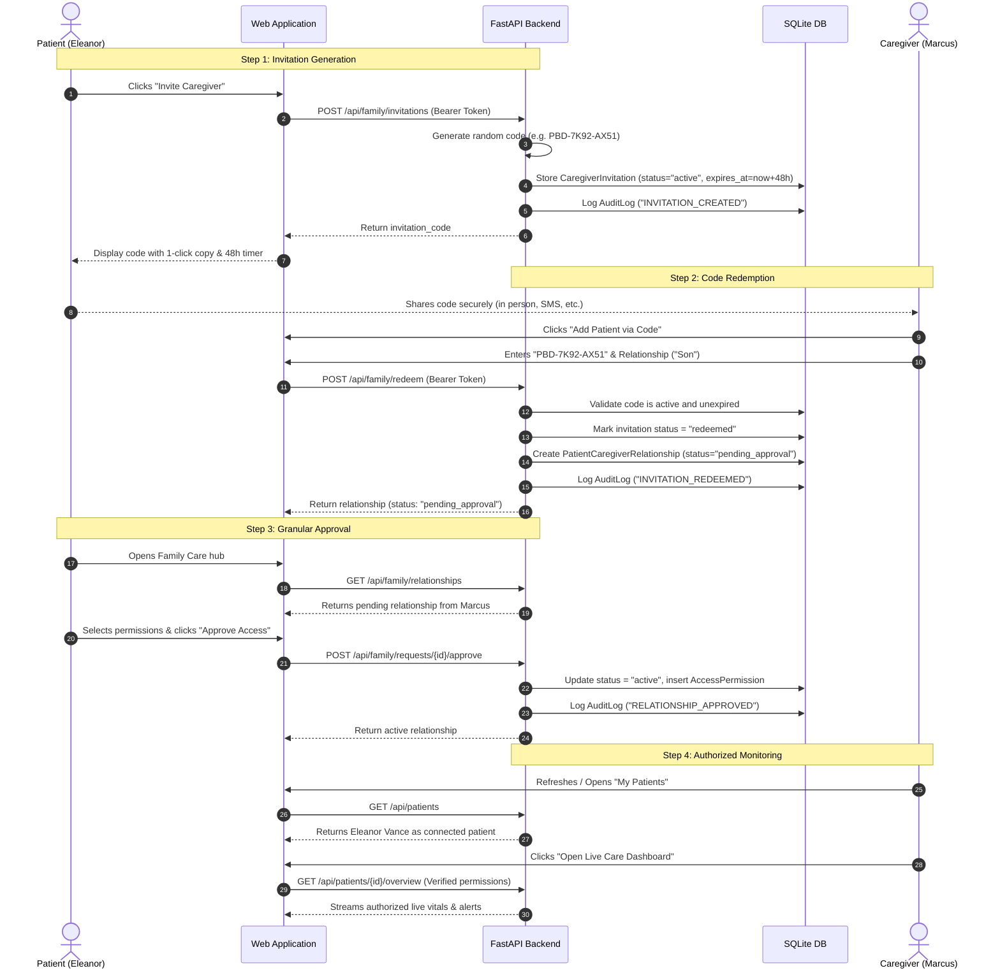

# PulseBridge Duo — Family Connection Workflow Specification

## 1. Executive Summary

PulseBridge Duo features a privacy-first, patient-controlled family onboarding mechanism. The platform bridges patients (e.g. elderly individuals or chronic disease patients) with authorized family caregivers (e.g. adult children, visiting nurses, or guardians) without requiring complex setup, exposing private contact numbers, or granting blanket access to sensitive medical records.

The workflow guarantees:
1. **Patient Sovereignty**: The patient initiates and governs all access.
2. **Cryptographic Single-Use Tokens**: Non-guessable codes in the format `PBD-XXXX-XXXX`.
3. **Time-Limited Expiry**: Tokens automatically expire after 48 hours.
4. **Explicit Consent & Granular Permissions**: Caregiver access is held in a `pending_approval` state until the patient explicitly reviews and specifies which of the 7 granular permissions are granted.
5. **Instant Revocation**: Patients can terminate access at any time, immediately blocking the caregiver's ability to view live or historical data.

---

## 2. Step-by-Step Connection Lifecycle



---

## 3. Security Properties & Boundary Defenses

### Single-Use Token Invalidation
Once redeemed via `POST /api/family/redeem`, the invitation token's database record is immediately updated:
```python
inv.status = "redeemed"
db.commit()
```
Any subsequent attempt to use the same token is rejected with an HTTP 404/400 error (`"Invalid or inactive invitation code"`), preventing replay attacks or unauthorized third-party links.

### Cryptographic Entropy
Invitation codes are formed using Python's cryptographically secure pseudo-random number generator (`secrets.choice`):
```python
chars = string.ascii_uppercase + string.digits
part1 = ''.join(secrets.choice(chars) for _ in range(4))
part2 = ''.join(secrets.choice(chars) for _ in range(4))
code = f"PBD-{part1}-{part2}"
```
With 36 potential alphanumeric characters across 8 positions, the search space exceeds $36^8 \approx 2.82 \times 10^{12}$ combinations, precluding brute-force guessing during the 48-hour window.

### Immediate Revocation
When a patient deletes or revokes a relationship (`DELETE /api/family/relationships/{id}`):
1. `rel.status` is set to `"revoked"`.
2. `rel.revoked_at` timestamp is set to `utc_now()`.
3. `AuditLog` records the termination.
4. Any subsequent caregiver requests for that patient's endpoints (`/api/patients/{id}/*`) immediately fail with `403 Forbidden` (`"Access forbidden: Active relationship not found"`).
