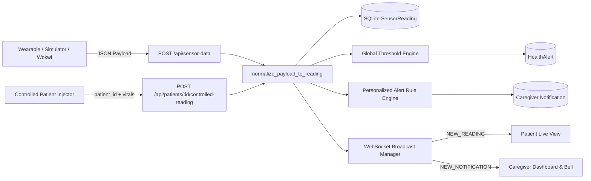

# PulseBridge Duo — Shared Monitoring Architecture

## 1. Overview

Shared monitoring enables authorized family caregivers to review live physiological telemetry, track clinical stability, and observe acute changes in a connected patient's health without imposing invasive surveillance or compromising patient autonomy.

---

## 2. Telemetry Ingestion & Patient Association

PulseBridge Duo ingests multi-modal wearable telemetry from multiple physical and simulated sources:
- **`PB-RING-01`**: Continuous photoplethysmography (PPG), pulse rate, SpO2, and micro-capillary perfusion.
- **`PB-WATCH-01`**: Accelerometer, blood pressure oscillometric estimation, skin/ambient temperature, and active display.
- **`PB-ESP32-01`**: Wokwi Hardware-in-the-Loop bridge emitting canonical JSON over HTTP POST.
- **`CONTROLLED_TEST_INJECTOR`**: Interactive demonstration injector enabling judges to test personalized patient alert rules on demand.

### Canonical Telemetry Pipeline

---

## 3. Real-Time WebSocket Telemetry Streaming

The platform provides bidirectional WebSocket connectivity at `/api/ws`. Connected clients receive typed real-time events whenever new sensor data is processed:

1. **`NEW_READING`**: Emitted on any global or hardware telemetry ingestion. Contains normalized vital signs, source, signal quality, and any newly triggered health alerts.
2. **`PATIENT_READING_UPDATED`**: Emitted when a reading specifically associated with a `patient_id` is ingested.
3. **`NEW_NOTIFICATION`**: Emitted when a personalized patient alert rule fires, delivering instant notifications to the caregiver's header bell and notification drawer.

---

## 4. Controlled Reading Injector (Judge & Demo Tool)

To allow judges, clinicians, and reviewers to test acute scenario responses without having to run physical hardware or wait for natural fluctuations, PulseBridge Duo includes a **Controlled Reading Injector** built directly into the Caregiver Monitoring Dashboard (`/patient-monitor/:patientId`):

1. **Customizable Inputs**: Heart Rate (bpm), SpO2 (%), Systolic/Diastolic BP (mmHg).
2. **One-Click Presets**:
   - *Acute Hypoxia & Tachycardia*: HR = 145 bpm, SpO2 = 87%, BP = 165/95 mmHg.
   - *Normal Baseline*: HR = 72 bpm, SpO2 = 98%, BP = 120/80 mmHg.
3. **Instant Verification**:
   - Submits `POST /api/patients/{patient_id}/controlled-reading`.
   - Evaluates the patient's personalized alert rules (e.g. Eleanor's rule: `spo2_percent < 92.0%` or `heart_rate_bpm > 110.0 bpm`).
   - Automatically stores the reading in `sensor_readings`.
   - Generates the `HealthAlert` record.
   - Dispatches persistent `Notification` records to caregiver Marcus Vance.
   - Updates the live UI cards and rings within milliseconds.
